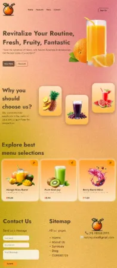
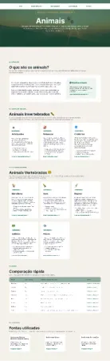
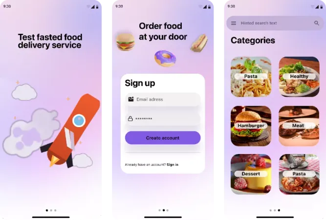
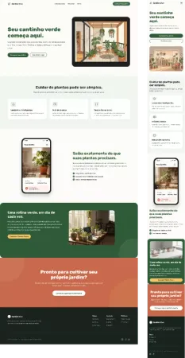
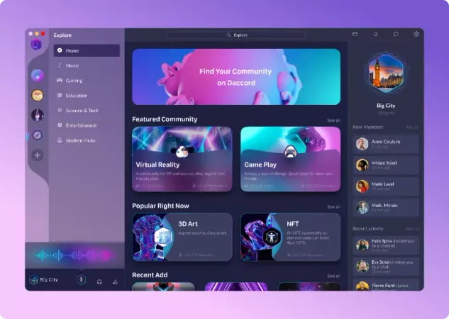

# Portfólio de Design

Interfaces e protótipos de UI criados no Figma durante meus estudos de design e front-end. Cada link abre o protótipo navegável, sem necessidade de instalação.

## Projetos

### Login Page

Tela de autenticação com fundo abstrato, campos de e-mail e senha, opção de manter a sessão e recuperação de senha.

`Desktop` `UI` · [Abrir protótipo](https://www.figma.com/proto/T5ct65090wS3CkRuRRjsQm/Login-Page?node-id=2-2&p=f&t=cFqQnB1dWuc2pPcJ-0&scaling=scale-down&content-scaling=fixed&page-id=0%3A1)

### Juice Website

Landing page para uma marca de sucos, com apresentação da proposta, benefícios, cardápio, contato e rodapé completo.

`Desktop` `Landing page` · [Abrir protótipo](https://www.figma.com/proto/RJVtCmTlkKkB4TyPEhvr4d/Juice-Website?node-id=1-3&p=f&t=dDor3AnhQU1tzpVv-0&scaling=contain&content-scaling=responsive&page-id=0%3A1)

### Animais — Guia de Classificação

Página educativa sobre a classificação dos animais, com introdução, grupos de invertebrados e vertebrados, tabela comparativa e fontes.

`Desktop` `Conteúdo` · [Abrir protótipo](https://www.figma.com/proto/KpufKhgpqsohceI4opJVo9/Animais---Guia-de-Classifica%C3%A7%C3%A3o?node-id=1-24&p=f&t=xdU3OWt4MM4Akvin-0&scaling=min-zoom&content-scaling=fixed&page-id=0%3A1)

### Food Delivery

Fluxo mobile de um aplicativo de delivery, com tela de apresentação, cadastro e catálogo organizado por categorias.

`Mobile` `App` · [Abrir protótipo](https://www.figma.com/proto/hQKA3noB1ybNx6BuCwkMET/Food-Delivery?node-id=16-2&p=f&t=uGlmaAG1FJ69Y28n-0&scaling=scale-down&content-scaling=fixed&page-id=0%3A1)

### Jardinagem

Landing page para um serviço de jardinagem, com proposta principal, benefícios, apresentação do aplicativo e chamada para contato.

`Desktop` `Landing page` · [Abrir protótipo](https://www.figma.com/proto/SEUxnY5bOKKsCGPEQKtJ2u/Jardinagem?node-id=2-2&t=dERPPOeRGDLRM0Z1-0&scaling=min-zoom&content-scaling=fixed&page-id=0%3A1&starting-point-node-id=2%3A2)

### Carros

Landing page automotiva com hero de impacto, vitrine de modelos, recursos de performance, indicadores e chamada final.

`Desktop` `Landing page` · [Abrir protótipo](https://www.figma.com/proto/CUWpr0dByNFega8x2F3CjG/Carros?node-id=2-4&p=f&t=pCCB1m5q7qPVEpxn-0&scaling=min-zoom&content-scaling=fixed&page-id=0%3A1&starting-point-node-id=2%3A4)

### Daccord

Interface de comunidade no estilo dashboard, com navegação lateral, comunidades em destaque, conteúdos populares e atividade recente.

`Desktop` `Dashboard` · [Abrir protótipo](https://www.figma.com/proto/W0uyTJS7U3skQI03PsrpHC/Daccord?node-id=2-2&p=f&t=KKmgQ1899FFLpGHU-0&scaling=min-zoom&content-scaling=fixed&page-id=0%3A1)

## Sobre

Os protótipos foram desenhados no Figma, com foco em hierarquia visual, consistência entre telas e navegação clara. As imagens acima são prévias estáticas; o comportamento completo, as transições e os fluxos estão disponíveis nos links de cada projeto.

---

Autor: Gilvam Oliveira · [LinkedIn](https://www.linkedin.com/in/gilvam-oliveira/) · [GitHub](https://github.com/GilvamOliveira)
